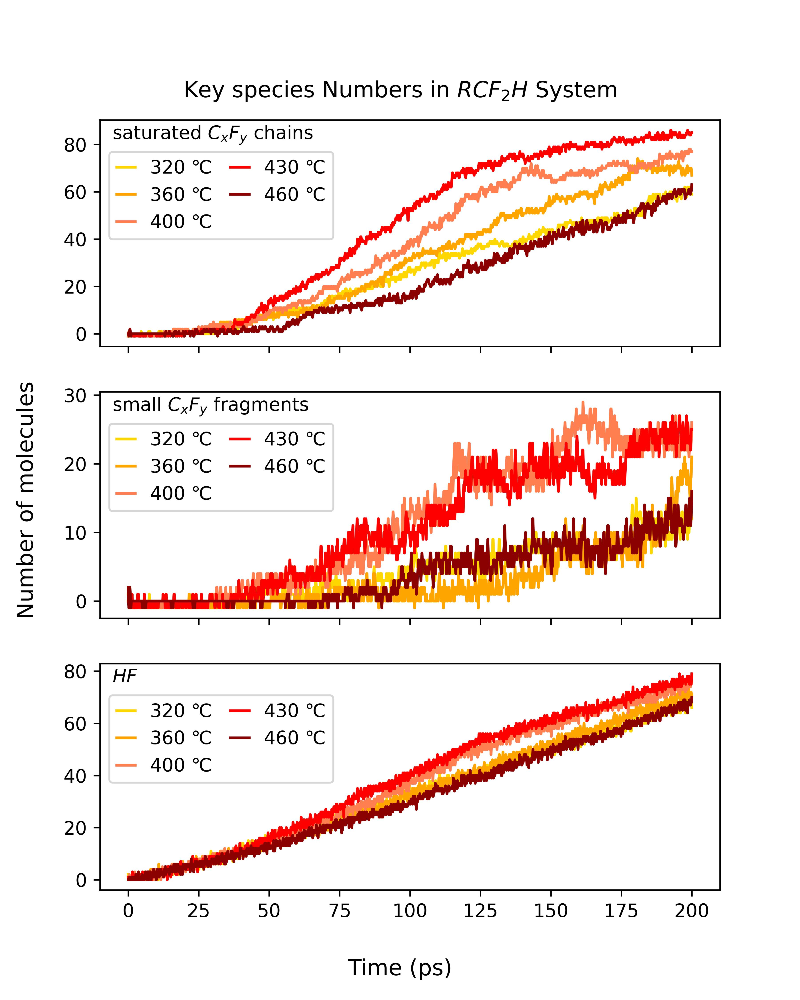
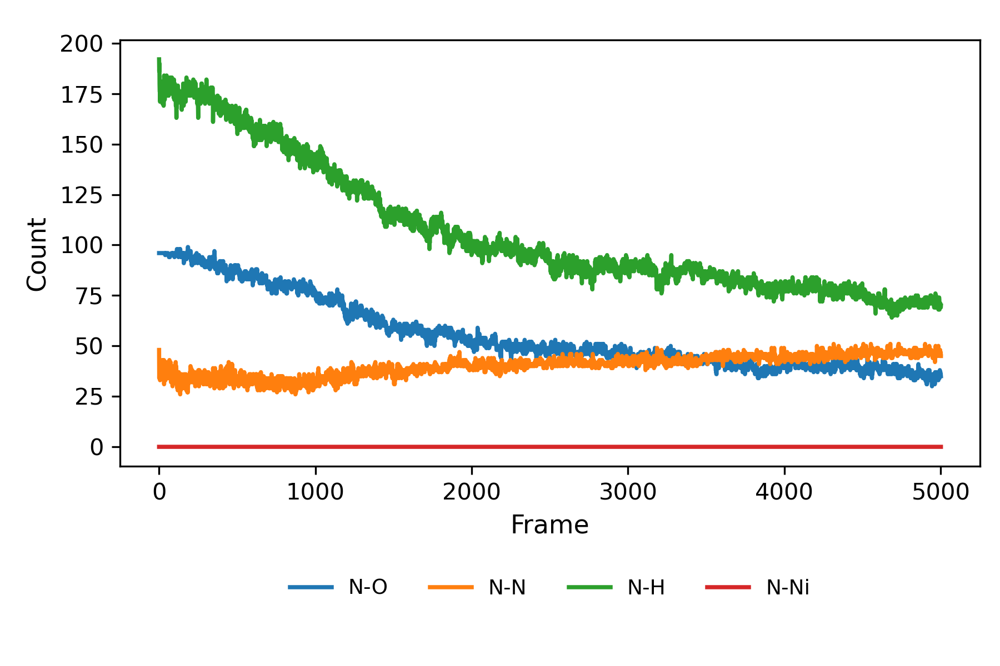
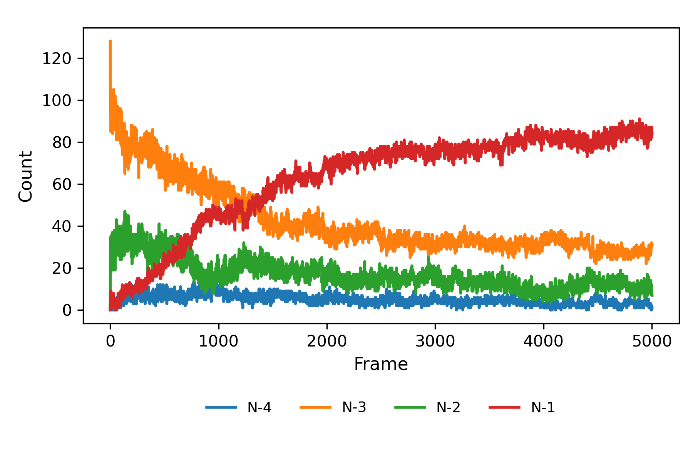
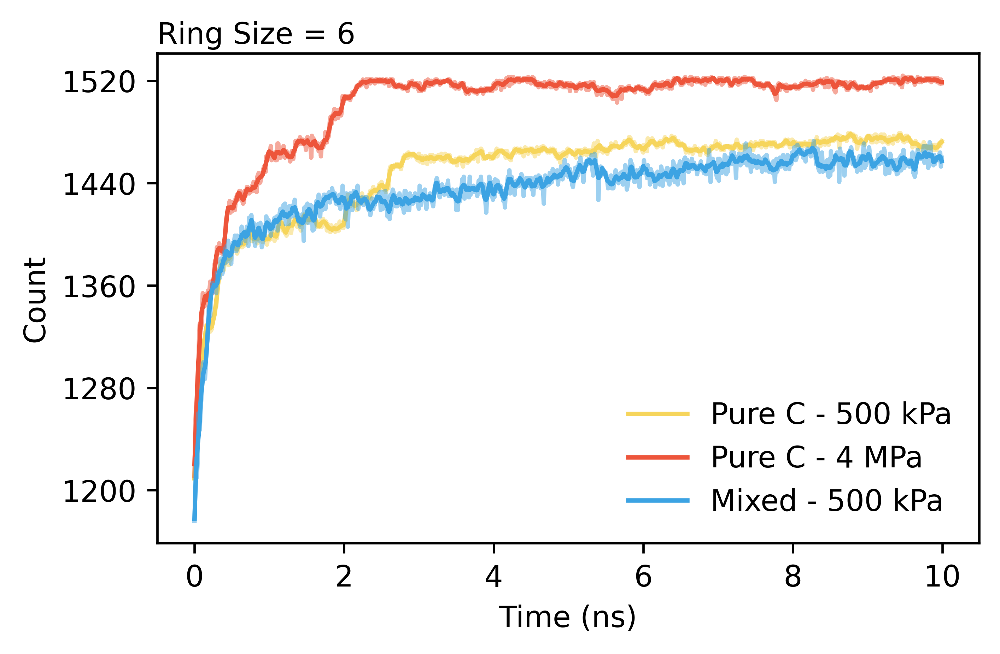
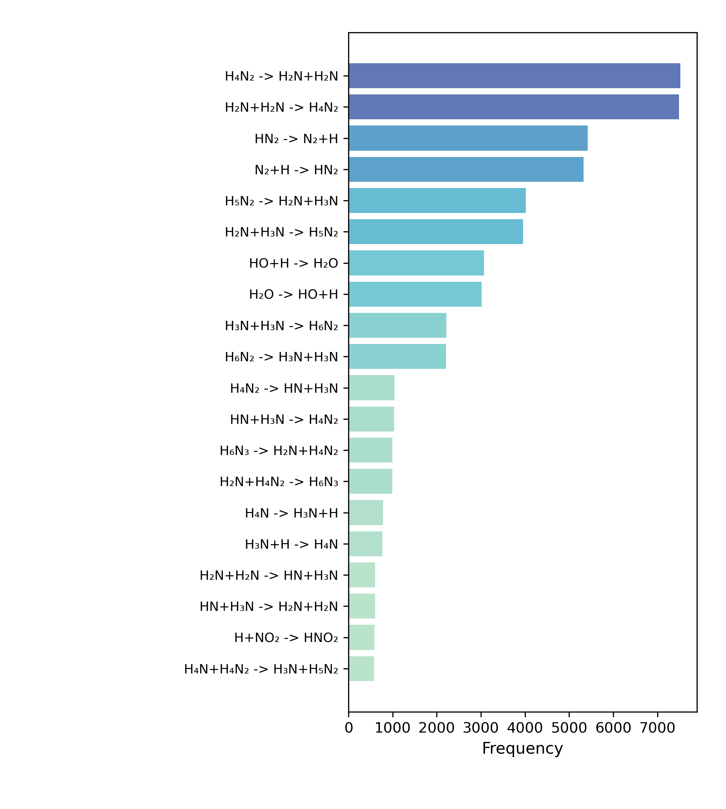
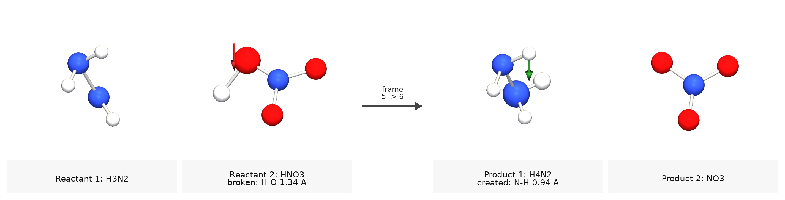
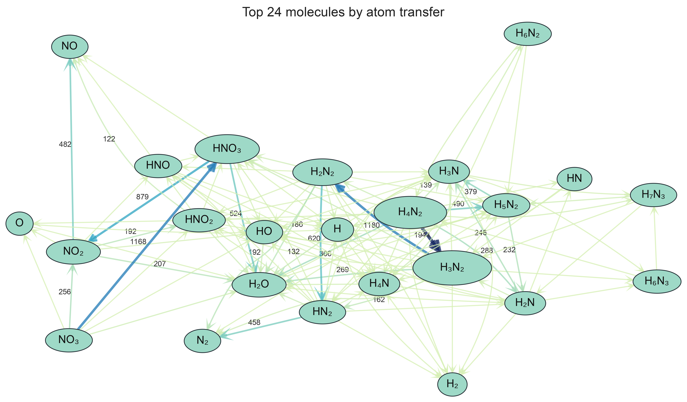
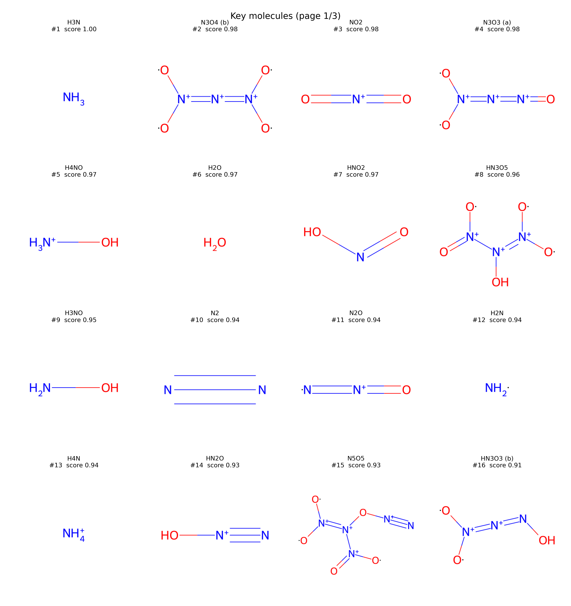

# ReaxTools

English | [中文](README_zh.md)

ReaxTools is a local post-processing toolkit for ReaxFF, machine-learning-potential, AIMD, and other reactive molecular dynamics trajectories. It reads XYZ or LAMMPS dump files, identifies bonds and molecules, counts species, reaction events, and atom transfers by structure, and writes auditable CSV files and figures.

## Core features

| Feature | Example |
| --- | --- |
| Species abundance |  |
| Bond counts |  |
| Coordination number |  |
| Ring counts |  |
| Reaction frequency |  |
| Reaction pathway |  |
| Transfer network |  |
| Key structures |  |

## Installation and quick start

```bash
git clone https://github.com/tgraphite/reax_tools
cd reax_tools
bash install_reax_tools.sh
```

Dependencies:

- CMake 3.14+ and a C++17 compiler.
- Python 3.8+ with `numpy`, `pandas`, `matplotlib`, and `PyYAML`.
- Graphviz and PyGraphviz for network figures.
- RDKit is optional; it is used by the `molecules` command and by the 2D key-structure figures from `plot`.

The C++ core can also be built directly:

```bash
cmake -S . -B build -DCMAKE_BUILD_TYPE=Release
cmake --build build -j
./bin/reax_tools_core -f test/energetic.xyz -o output
```

Typical usage:

```bash
reax_tools -f test/energetic.xyz -o output
reax_tools plot -f output
```

LAMMPS dump files require a type mapping:

```bash
reax_tools -f dump.lammpstrj -t C,H,O,N -o output
```

Common options:

| Option | Description |
| --- | --- |
| `-f, --traj` | Input trajectory, `.xyz` or `.lammpstrj` |
| `-o, --output` | Output directory |
| `-t, --types` | LAMMPS dump type order, e.g. `C,H,O,N` |
| `-r, --rescale-vdw` | Global vdW radius scale, default 1.2 |
| `-tr, --type-radius` | Per-element radius override, e.g. `N:1.5 O:1.6` |
| `-tv, --type-valence` | Per-element maximum valence override, e.g. `N:4 O:3` |
| `-nt, --threads` | Number of frame-processing threads |
| `--no-rings` | Disable ring detection |
| `--no-reactions` | Disable transfer-flow analysis |
| `--no-track-reactions` | Disable reaction-event tracking |

Plotting commands:

```bash
reax_tools plot -f output
reax_tools counts -f output
reax_tools events -f output
reax_tools network -f output
reax_tools flow -f output
reax_tools focus -f output
reax_tools molecules -f output
reax_tools summary -f output
```

`plot` generates all recommended figures in one pass.

## Current limitations

1. Triclinic cells and per-axis periodicity are not supported.
2. Electronic structure is not included.
3. Only constitutional isomers of small and medium molecules are resolved.

## Community publications

As of October 2026, the community has published more than 20 related works. A selection is listed below.

| System | Paper | Link |
| --- | --- | --- |
| Thermal degradation of amine solutions for CO2 capture | Thermal degradation and inhibition of long-chain triamines for CO2 capture, `Chem. Eng. J.` 2026 | [DOI](https://doi.org/10.1016/j.cej.2026.174329) |
| Plasma graphene nanoflakes | Experimental and ReaxFF MD simulation study on plasma gas-phase synthesis of graphene nanoflakes, `Diamond Relat. Mater.` 2025 | [DOI](https://doi.org/10.1016/j.diamond.2025.113141) |
| Three-phase gel foam for fire suppression | Optimization and performance assessment of an eco-friendly three-phase gel foam for liquid fires, `Colloids Surf. A` 2026 | [DOI](https://doi.org/10.1016/j.colsurfa.2026.141146) |
| Ethanol on Al(111) | Adsorption and thermal decomposition mechanisms of ethanol on Al(111), `J. Anal. Appl. Pyrolysis` 2026 | [DOI](https://doi.org/10.1016/j.jaap.2026.107932) |
| Pulsed-potential restructuring of Cu surfaces | Atomistic Origin of Non-equilibrium Surface Restructuring on Copper under Pulsed Potentials, `JACS` 2026 | [DOI](https://doi.org/10.1021/jacs.6c09411) |
| Huadian oil shale kerogen pyrolysis | A ReaxFF molecular dynamics study on the bond cleavage priority in the pyrolysis process of Huadian oil shale kerogen, `Fuel` 2026 | [DOI](https://doi.org/10.1016/j.fuel.2026.141081) |
| Cellulose steam gasification | Fe2O3-assisted steam gasification of cellulose: a ReaxFF molecular dynamics study, `Process Saf. Environ. Prot.` 2026 | [DOI](https://doi.org/10.1016/j.psep.2026.109259) |

## Citation

Hanxiang Chen, ReaxTools: A high-performance ReaxFF/AIMD trajectory analysis tool based on graph theory. https://github.com/tgraphite/reax_tools [Computer Software], retrieved on [date], or a similar citation.
