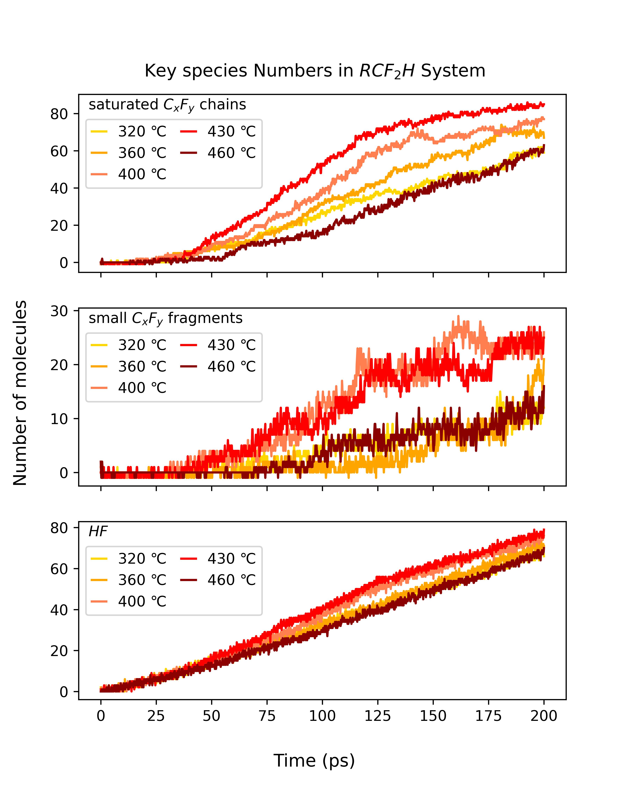
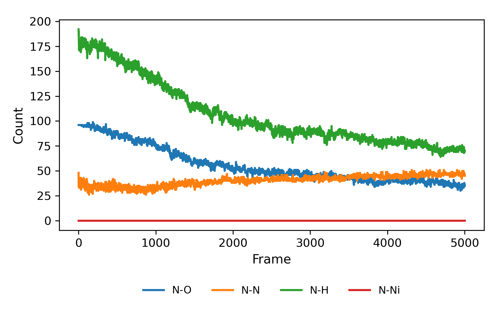
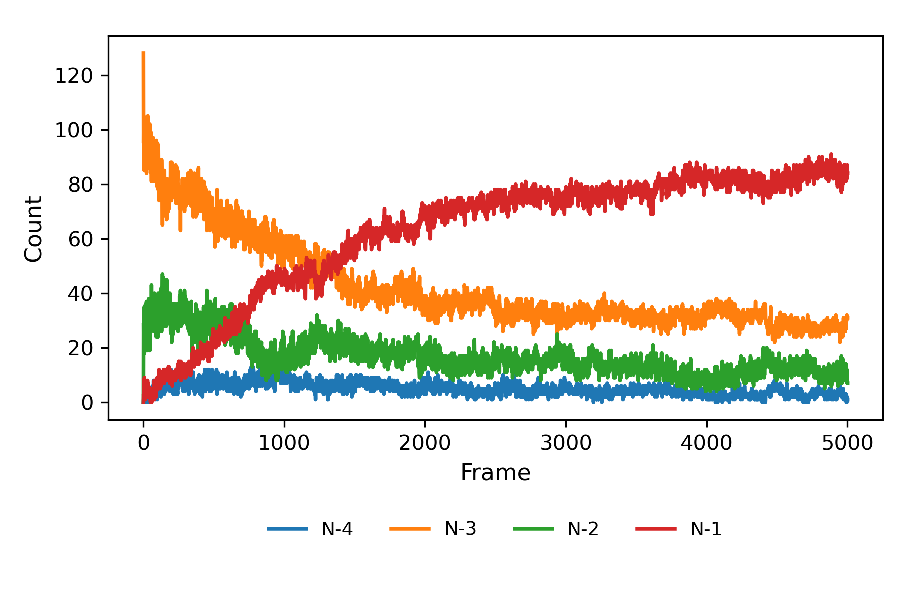
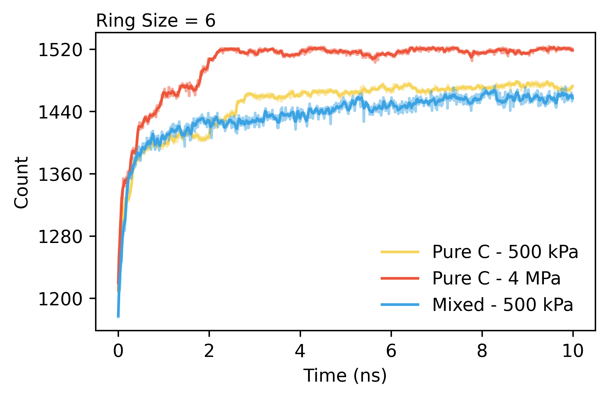
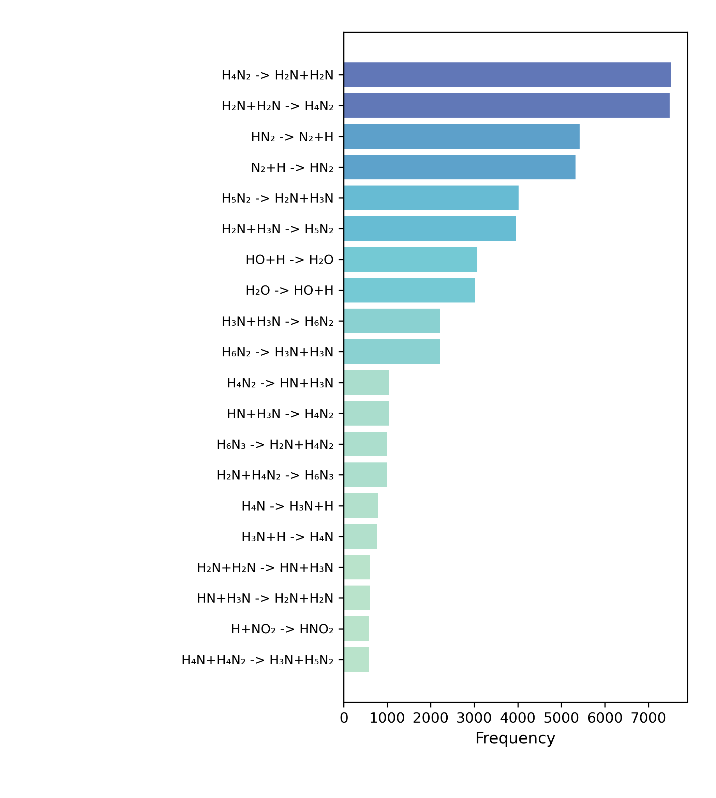
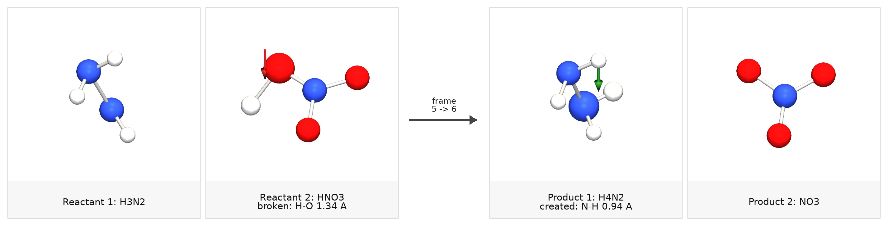
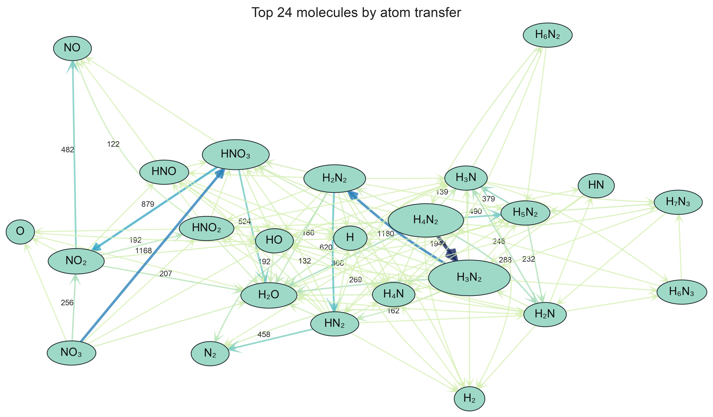
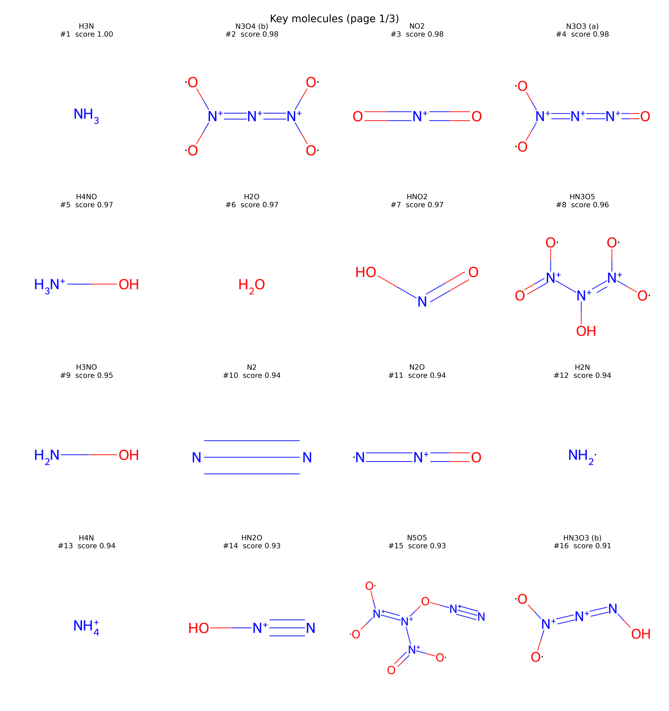

# ReaxTools

[English](README.md) | 中文

ReaxTools 是面向 ReaxFF/机器学习势/AIMD 等任意反应分子动力学轨迹的本地后处理工具。ReaxTools从 XYZ 或 LAMMPS dump 中识别键和分子，按结构统计物种、反应事件和原子转移，输出可审计的 CSV 与图表。

## 核心功能

| 功能     | 示例                                                                         |
| -------- | ---------------------------------------------------------------------------- |
| 物质含量 |      |
| 键统计   |          |
| 配位数   |      |
| 环统计   |          |
| 反应频次 |    |
| 反应路径 |  |
| 转移网络 |      |
| 关键结构 |    |


## 安装与快速使用

```bash
git clone https://github.com/tgraphite/reax_tools
cd reax_tools
bash install_reax_tools.sh
```

依赖：

- CMake 3.14+，C++17 编译器。
- Python 3.8+，以及 `numpy`、`pandas`、`matplotlib`、`PyYAML`。
- 网络图需要 Graphviz 和 PyGraphviz。
- RDKit 可选，用于 `molecules` 命令和 `plot` 生成的 2D 关键结构图。

也可以直接编译 C++ core：

```bash
cmake -S . -B build -DCMAKE_BUILD_TYPE=Release
cmake --build build -j
./bin/reax_tools_core -f test/energetic.xyz -o output
```

典型使用方法：

```bash
reax_tools -f test/energetic.xyz -o output
reax_tools plot -f output
```

LAMMPS dump 需要指定类型映射：

```bash
reax_tools -f dump.lammpstrj -t C,H,O,N -o output
```

常用参数：

| 参数                   | 作用                                 |
| ---------------------- | ------------------------------------ |
| `-f, --traj`           | 输入轨迹，`.xyz` 或 `.lammpstrj`     |
| `-o, --output`         | 输出目录                             |
| `-t, --types`          | LAMMPS dump 的类型顺序，如 `C,H,O,N` |
| `-r, --rescale-vdw`    | 全局 vdW 半径缩放，默认 1.2          |
| `-tr, --type-radius`   | 单元素半径覆盖，如 `N:1.5 O:1.6`     |
| `-tv, --type-valence`  | 单元素最大价态覆盖，如 `N:4 O:3`     |
| `-nt, --threads`       | 帧处理线程数                         |
| `--no-rings`           | 关闭环检测                           |
| `--no-reactions`       | 关闭 transfer-flow 分析              |
| `--no-track-reactions` | 关闭反应事件跟踪                     |
| `--dump N`             | 在 0 基帧号 0, N, 2N, ... 输出 `frame_<id>.data`（文件名仍为 1 基） |
| `--dumpxyz N`          | 在相同 0 基帧号输出一个 `<basename>.marked.xyz` |
| `--mark-ring-atoms`    | `--dump` 的 molecule-ID 列改存原子环尺寸 |

### 三斜晶胞与结构导出

ReaxTools 支持扩展 XYZ 中的一般三斜晶胞，以及 LAMMPS dump 的 restricted
triclinic 盒子。XYZ 的 `Lattice` 采用 OVITO/ASE 的列优先约定：
`ax ay az bx by bz cx cy cz`。LAMMPS dump 的 `xy/xz/yz` 倾斜因子会先反算成
真实盒子边界，再进行原子包裹。

`--dump N` 输出包含 atoms、bonds、angles、dihedrals 的 LAMMPS data 文件。
元素 type ID 在整条轨迹中只分配一次，因此每一帧的 `type -> 元素` 映射一致。
molecule-ID 列默认按分子原子数从大到小排序，便于区分独立分子。使用
`--mark-ring-atoms` 时，同一列改存该原子所属的最小环尺寸；非环原子为 0，
配合 `--no-rings`（或别名 `--no-ring`）时静默输出全 0，不报错。

`--dumpxyz N` 输出单个多帧扩展 XYZ 文件，包含 `id`、`molecule`、
`molsize`、`ringsize`、`formula`、`molmass` 和 `mol<元素>` 字段，
可直接用 OVITO 打开。OVITO 3.15 会跳过可选的字符串 `formula` 列并给出警告，
但所有数值字段正常读取；OVITO 3.17 也支持该字符串列。`mol<元素>` 列由
`-t/--types` 或首帧固定，因此轨迹的元素组成应保持不变（反应 MD 的常态）。

绘图命令：

```bash
reax_tools plot -f output
reax_tools counts -f output
reax_tools events -f output
reax_tools network -f output
reax_tools flow -f output
reax_tools focus -f output
reax_tools molecules -f output
reax_tools summary -f output
```

`plot` 默认一次性生成所有推荐的图表。

## 当前限制

1. LAMMPS dump 必须是 restricted triclinic 盒子；可选的
   `ITEM: BOX BOUNDS general triclinic` 形式会明确报错；
2. 与电子结构无关；
3. 仅区分中小分子构造异构体。

## 社区发表论文

截至2026年10月，社区已发表20+篇相关工作，以下为部分内容。

| 体系                  | 论文                                                                                                                               | 链接                                                  |
| --------------------- | ---------------------------------------------------------------------------------------------------------------------------------- | ----------------------------------------------------- |
| CO₂ 捕集胺液热降解    | Thermal degradation and inhibition of long-chain triamines for CO2 capture, `Chem. Eng. J.` 2026                                   | [DOI](https://doi.org/10.1016/j.cej.2026.174329)      |
| 等离子体石墨烯纳米片  | Experimental and ReaxFF MD simulation study on plasma gas-phase synthesis of graphene nanoflakes, `Diamond Relat. Mater.` 2025     | [DOI](https://doi.org/10.1016/j.diamond.2025.113141)  |
| 三相凝胶泡沫灭火材料  | Optimization and performance assessment of an eco-friendly three-phase gel foam for liquid fires, `Colloids Surf. A` 2026          | [DOI](https://doi.org/10.1016/j.colsurfa.2026.141146) |
| 乙醇/Al(111) 表面反应 | Adsorption and thermal decomposition mechanisms of ethanol on Al(111), `J. Anal. Appl. Pyrolysis` 2026                             | [DOI](https://doi.org/10.1016/j.jaap.2026.107932)     |
| 铜表面脉冲电位重构    | Atomistic Origin of Non-equilibrium Surface Restructuring on Copper under Pulsed Potentials, `JACS` 2026                           | [DOI](https://doi.org/10.1021/jacs.6c09411)           |
| 桦甸油页岩干酪根热解  | A ReaxFF molecular dynamics study on the bond cleavage priority in the pyrolysis process of Huadian oil shale kerogen, `Fuel` 2026 | [DOI](https://doi.org/10.1016/j.fuel.2026.141081)     |
| 纤维素蒸汽气化        | Fe2O3-assisted steam gasification of cellulose: a ReaxFF molecular dynamics study, `Process Saf. Environ. Prot.` 2026              | [DOI](https://doi.org/10.1016/j.psep.2026.109259)     |

## 引用

Hanxiang Chen, ReaxTools: A high performace ReaxFF/AIMD trajectory analysis tool based on graph theory. https://github.com/tgraphite/reax_tools [Computer Software], retrived on [date]
或相似表述。